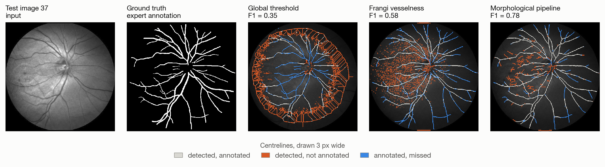
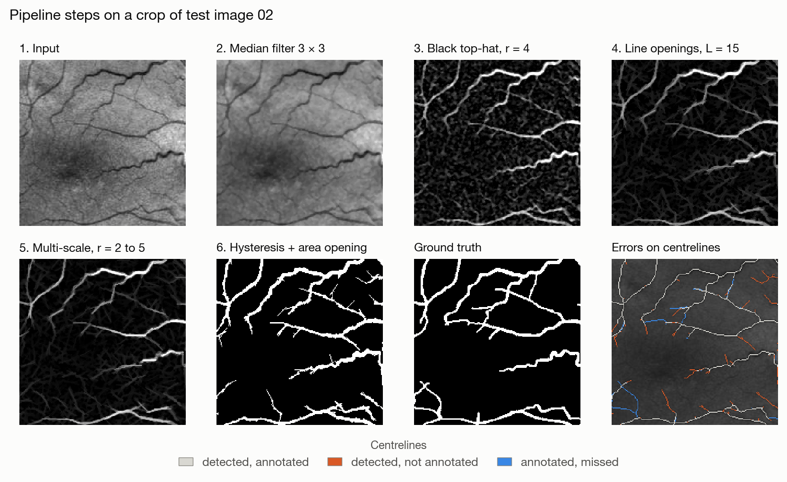
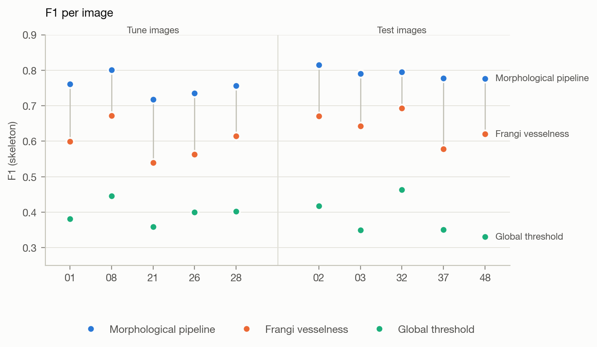
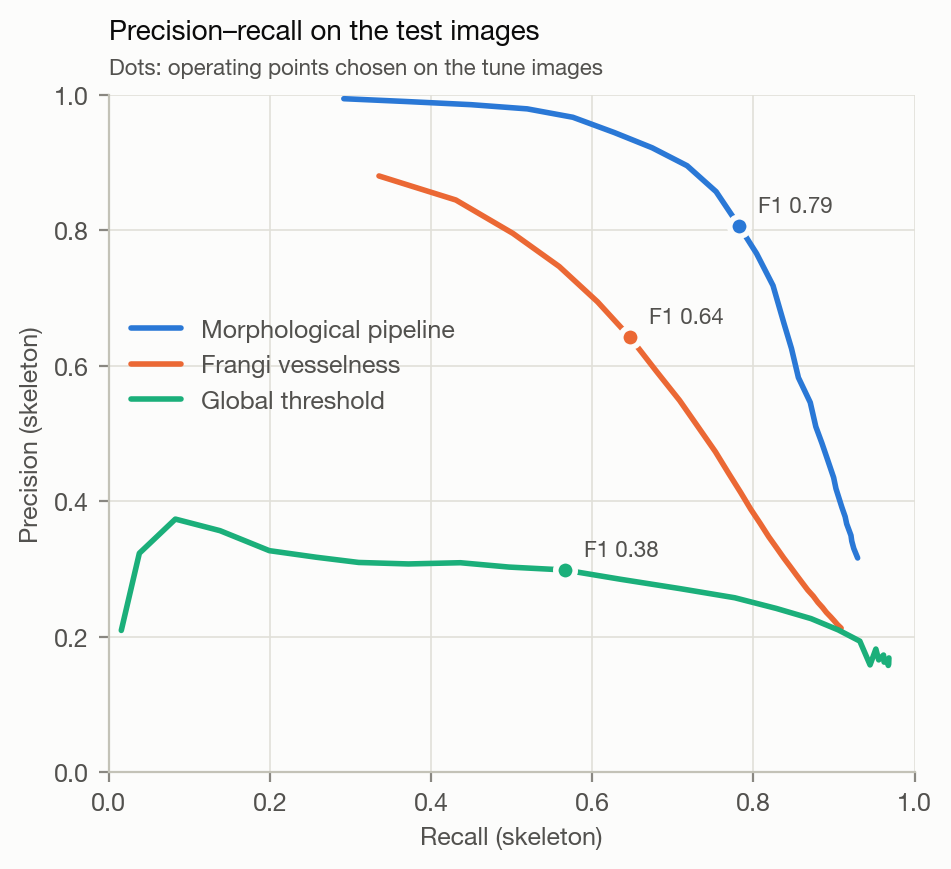
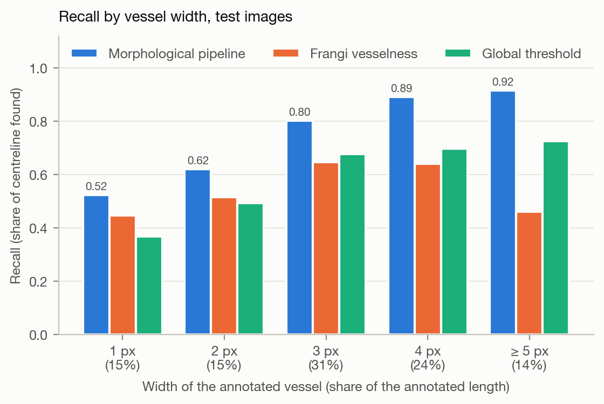
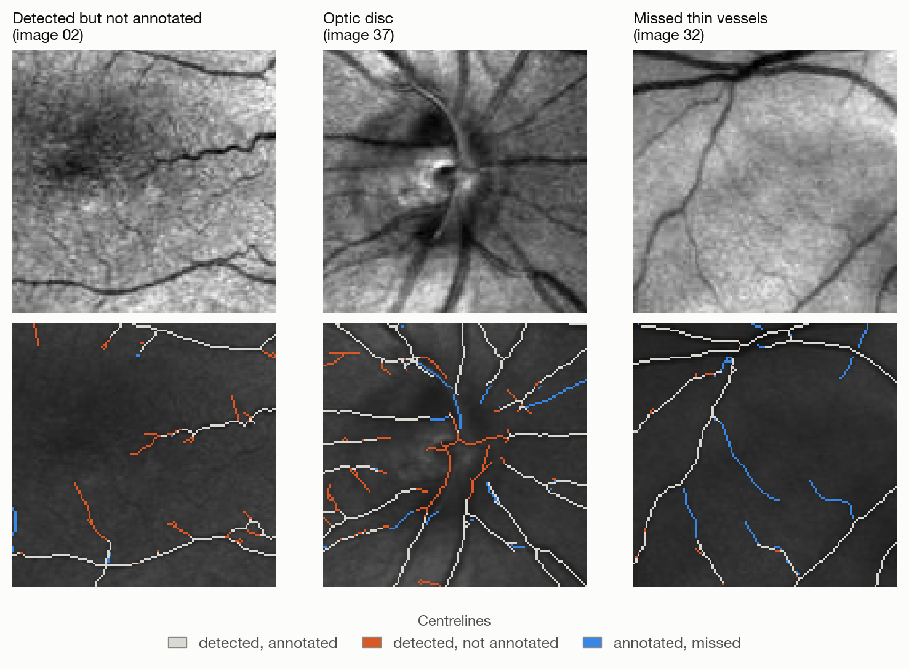
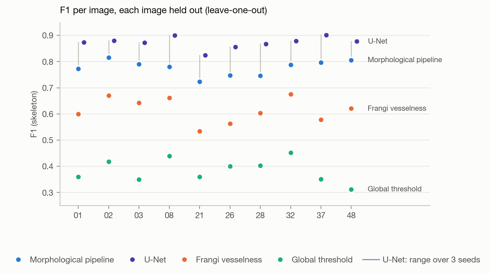
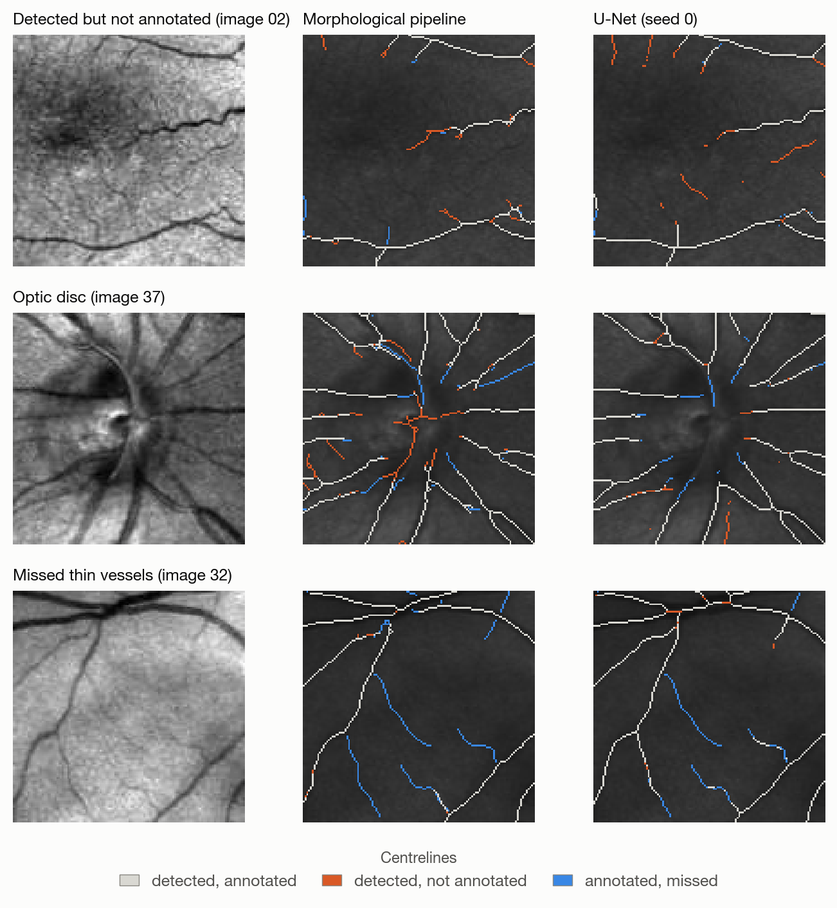

# Retinal vessel segmentation in SLO images

Automatic segmentation of the blood vessel network in scanning laser
ophthalmoscopy (SLO) images of the retina, using mathematical morphology.
Quantitative analysis of this network helps diagnose conditions such as
hypertension or renal failure.

The pipeline is tuned on 5 images, evaluated once on 5 others, and its
failures are analysed; it is then compared with a small U-Net under
leave-one-out cross-validation, which the U-Net wins clearly.



## Setup

```bash
git clone https://github.com/RowanHoupa35/Retinal-vessel-segmentation-in-SLO-images.git
cd Retinal-vessel-segmentation-in-SLO-images
conda env create -f environment.yml    # installs the package in editable mode
conda activate vessels
python scripts/download_data.py        # fetches the images
pytest
python scripts/evaluate_baselines.py   # writes results/baselines/
python scripts/ablation.py --test      # tunes on tune, then evaluates on test (~5 min)
python scripts/analyze_errors.py       # writes results/analysis/
python scripts/cv_pipeline.py          # leave-one-out, pipeline and references (~6 min)
python scripts/cv_unet.py              # leave-one-out, U-Net; needs PyTorch (~2 h, M1 Max GPU)
python scripts/cv_compare.py           # writes results/cross_validation/summary.md
python scripts/make_figures.py         # writes results/figures/
```

```python
from vessels.data import load_image
from vessels.pipeline import segment

vessels = segment(load_image("01"))    # boolean mask, tuned parameters by default
```

## Method

Vessels are dark, 1 to 5 px wide at this resolution, on a background whose
brightness varies across the image.

1. **Median filter** (3 × 3): removes the fine noise that step 2 would pick up.
2. **Black top-hat** (closing minus image): extracts dark structures narrower
   than the disk and removes the non-uniform background.
3. **Supremum of line openings** (length 15, 12 orientations, after Zana &
   Klein): a vessel survives the opening aligned with it, a blob does not.
4. **Multi-scale**: steps 2-3 with disk radii 2, 3, 4 and 5, each response
   divided by its standard deviation, then averaged.
5. **Hysteresis threshold**, written as a geodesic reconstruction: faint
   pixels are kept only if connected to strong seeds.
6. **Area opening**: removes connected components under 50 px.

Thresholds are expressed as the share of the field of view kept (12 %), as
the response has no fixed scale.



## Data

Ten 512 × 512 grayscale images from the IOSTAR dataset with expert vessel
annotations. The images are not committed; `download_data.py` fetches the
subset distributed with the course and checks its SHA-256.

## Evaluation protocol

- **Metric.** Precision and recall are computed on skeletons, as in the course
  script: precision is the share of the predicted centreline lying inside
  annotated vessels; recall is TP / (TP + FN), with TP counted on the
  predicted centreline and FN on the annotated one. This weighs thin and thick
  vessels equally and tolerates imprecise annotated borders, but it barely
  penalises over-thick segmentations (see `tests/test_evaluation.py`), so the
  pixel-wise Dice is reported too. Because TP and FN come from two different
  skeletons, the recall also grows with the length of the predicted skeleton:
  it overstates Frangi's by 0.076 compared with the share of the annotated
  centreline actually covered (the pipeline's two values differ by 0.006;
  details in [`results/analysis/errors.md`](results/analysis/errors.md)).
- **Split.** Parameters are chosen on 5 tune images (01, 08, 21, 26, 28);
  final numbers come from the 5 other images (02, 03, 32, 37, 48). Both
  halves contain left and right eyes, macula-centred and disc-centred images.

## Results

### Test set

Evaluated once, with every parameter chosen on the tune images beforehand.
Mean ± standard deviation over the 5 test images.

| Method | Precision | Recall | F1 | Dice |
|---|---|---|---|---|
| Global threshold (course, T = 80) | 0.299 ± 0.073 | 0.566 ± 0.095 | 0.382 ± 0.056 | 0.278 ± 0.059 |
| Frangi vesselness | 0.643 ± 0.091 | 0.647 ± 0.033 | 0.641 ± 0.044 | 0.528 ± 0.039 |
| **Morphological pipeline** | **0.807 ± 0.063** | **0.782 ± 0.051** | **0.791 ± 0.016** | **0.749 ± 0.013** |

- The pipeline beats Frangi on each of the 10 images, by +0.10 to +0.20 F1.
  The mean gap is the same on tune (+0.157) and test (+0.150).
- Frangi and the pipeline score higher on test than on tune (pipeline:
  0.791 vs 0.754). Their two hardest images, 21 and 26, fell in the tune
  set; the split was fixed before any method was run, so this reflects
  image difficulty, not tuning. The global threshold, whose hardest images
  are 48, 03 and 37, scores slightly lower on test.

Per-image scores: [`results/pipeline/per_image.csv`](results/pipeline/per_image.csv).





The pipeline's curve lies above Frangi's everywhere, so the gain does not
depend on the chosen operating point (curve: kept fraction varied, seeds at
the same 3/4 ratio, area opening unchanged).

### Ablation

Cumulative rows add one step, re-tuned on the tune images (rule in
`scripts/ablation.py`); remove-one drops that step from the full pipeline.
Full tables: [`results/pipeline/ablation.md`](results/pipeline/ablation.md).

| Step | Tune F1 | Test F1 | Remove-one Δ F1 (tune / test) |
|---|---|---|---|
| Black top-hat | 0.594 | 0.650 | |
| + median filter | 0.690 | 0.703 | −0.053 / −0.028 |
| + line openings | 0.733 | 0.766 | −0.030 / −0.018 |
| + multi-scale | 0.746 | 0.786 | −0.015 / −0.015 |
| + hysteresis | 0.752 | 0.786 | −0.001 / +0.001 |
| + area opening | 0.754 | 0.791 | −0.003 / −0.005 |

- The contributions rank the same on both sets: denoising and line openings
  bring most of the gain.
- Multi-scale helps little: vessel widths span only 1 to 5 px here.
- Hysteresis adds nothing once area opening is there: both remove isolated
  components, and line openings already removed most of them.
- Filling small holes was tried and brought nothing (+0.001 on tune).

All numbers above use the course's field of view eroded by 3 px;
[`results/baselines/`](results/baselines/summary.md) keeps the step-1
reference numbers on the uneroded disk.

## Failure analysis

On the test images; details in
[`results/analysis/errors.md`](results/analysis/errors.md).



- **Thin vessels are the main source of misses.** Vessels 1 to 2 px wide make
  up 30 % of the annotated length; the pipeline finds 52 to 62 % of them,
  against 80 to 92 % for wider vessels. Frangi, by contrast, misses more than
  half of the vessels 5 px wide or more.
- **Most false positives are not alignment errors.** 77 % of them lie more
  than 2 px from any annotated vessel; tolerating a 2 px offset would only
  raise precision from 0.807 to 0.851.
- **The pipeline behaves as a contrast threshold.** Measured with a black
  top-hat of the raw image, the structures it detects without annotation have
  a median contrast of 13 gray levels, above the annotated thin vessels it
  misses (8) and well above the background (3). Many of them look like fine
  vessels absent from the annotation (crop below, left); a second annotator
  would be needed to tell how many.
- **The optic disc** produces false positives on its rim and texture (centre).
  This is shown, not measured: three simple ways of locating the disc
  automatically (brightness, convergence of thick vessels, local variance)
  each failed on at least 5 of the 10 images.



The crops were chosen by hand to illustrate each failure type.

## Comparison with a U-Net (leave-one-out)

Every image is scored by methods tuned (pipeline, references) or trained
(U-Net) on the 9 other images, which gives estimates on 10 images instead of
5. The pipeline is re-tuned in each fold with the ablation rule
(`vessels.tuning`). The U-Net (4 down-sampling stages, 16 base channels,
1.94 M parameters) is trained from scratch on 128 × 128 patches (flips,
quarter turns, intensity jitter; cross-entropy + Dice; AdamW, 4000 steps),
3 seeds per fold, 4.2 min per model on an Apple M1 Max GPU. Its recipe was
fixed beforehand: the training length was set from the training loss alone
(`scripts/cv_unet_pilot.py`), probabilities are thresholded at 0.5, and no
hyperparameter was tuned. Full tables:
[`results/cross_validation/summary.md`](results/cross_validation/summary.md).

| Method | Precision | Recall | F1 | Dice | F1 (covered recall) |
|---|---|---|---|---|---|
| Global threshold | 0.286 ± 0.048 | 0.616 ± 0.104 | 0.384 ± 0.045 | 0.279 ± 0.040 | 0.396 ± 0.045 |
| Frangi vesselness | 0.653 ± 0.100 | 0.592 ± 0.064 | 0.615 ± 0.048 | 0.487 ± 0.043 | 0.546 ± 0.061 |
| Morphological pipeline | 0.845 ± 0.059 | 0.723 ± 0.060 | 0.777 ± 0.029 | 0.731 ± 0.026 | 0.771 ± 0.031 |
| **U-Net** | **0.895 ± 0.035** | **0.855 ± 0.053** | **0.873 ± 0.022** | **0.812 ± 0.027** | **0.874 ± 0.021** |



- The U-Net beats the pipeline on every image, by 0.064 to 0.121 F1
  (Wilcoxon signed-rank p = 0.002). Its F1 varies by 0.004 across seeds on
  average, and the conclusion holds with the covered recall.
- It gains at every vessel width, most on the thinnest (1 px: 0.60 against
  0.37), and produces almost no false positives on the optic disc.
- Tuned on each set of 9 images, the pipeline picks the same configuration in
  all 10 folds.
- Among the structures the pipeline detects, at equal local contrast, the
  U-Net segments 93 % of the annotated thin vessels but only 21 % of the
  unannotated ones: it reproduces the annotator's selection. Whether these
  structures are vessels the annotator left out or non-vessel texture cannot
  be told without a second annotation.



## Credits

- Project subject: ENSTA Paris course CSC 4MI06, Antoine Manzanera.
- IOSTAR dataset: J. Zhang et al., "Robust retinal vessel segmentation via
  locally adaptive derivative frames in orientation scores", IEEE TMI, 2016;
  S. Abbasi-Sureshjani et al., "Biologically-inspired supervised vasculature
  segmentation in SLO retinal fundus images", ICIAR, 2015.
- A. F. Frangi et al., "Multiscale vessel enhancement filtering", MICCAI, 1998.
- F. Zana and J.-C. Klein, "Segmentation of vessel-like patterns using
  mathematical morphology and curvature evaluation", IEEE TIP, 2001.
